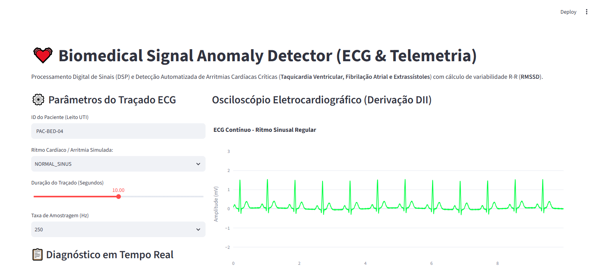

# 💓 Biomedical Signal Anomaly Detector (ECG & Telemetria)

[](https://www.python.org/downloads/)
[](#)
[](#)
[](#)
[](#)
[](#)

Pipeline de **Processamento Digital de Sinais (DSP)** e detecção de anomalias em traçados eletrocardiográficos (ECG a 250 Hz), identificando em tempo real arritmias ventriculares potencialmente letais (**Taquicardia Ventricular**), **Fibrilação Atrial** e **Extrassístoles (PVC)** com cálculo de variabilidade cardíaca (**RMSSD**).

---

## 📸 Validação Visual de Execução (Playwright E2E)

### Osciloscópio Digital Eletrocardiográfico e Diagnóstico em Tempo Real


---

## 🎯 Por que a Detecção de Arritmias em Tempo Real é Crítica?

Em unidades coronarianas e UTIs:
1. **Fadiga de Alarmes**: Mais de 70% dos alarmes em monitores hospitalares são falsos positivos provocados por ruído muscular, deslocamento de eletrodos ou oscilação de linha de base.
2. **Janela Terapêutica Estrita**: A taquicardia ventricular sem pulso ou fibrilação ventricular exige desfibrilação em menos de 2 minutos para sobrevivência neurológica intacta.
3. **Análise de Variabilidade Cardíaca (HRV)**: O índice RMSSD permite quantificar o tono autonômico parassimpático e detectar disautonomia prévia a eventos adversos.

---

## 🏛️ Estrutura Arquitetural (CRISP-DM + SDD)

```
biomedical-signal-anomaly-detector/
├── SPEC.md                           # Contratos Pydantic formais de entrada/saída
├── crisp_dm/
│   └── 01_business_understanding.md  # Fundamentação cardiológica e redução de alarm fatigue
├── src/
│   ├── schemas.py                    # Schemas Pydantic validados
│   ├── signal_engine.py              # DSP, algoritmo Pan-Tompkins e cálculo de RMSSD
│   └── app.py                        # Interface do monitor multiparamétrico (Streamlit)
├── tests/
│   └── unit/
│       └── test_signal.py            # Testes unitários com PyTest
├── docs/
│   └── screenshots/                  # Evidências Playwright E2E
├── Dockerfile                        # Implantação em container
└── requirements.txt                  # Dependências fixadas
```

---

## 🧪 Padrões de Ritmo e Gravidade Clínica

| Ritmo Cardíaco | Características Morfológicas | Nível de Urgência |
| :--- | :--- | :--- |
| **Ritmo Sinusal Regular** | Onda P antes de cada QRS, intervalo R-R constante | `NORMAL` |
| **Taquicardia Ventricular (TV)** | Complexos alargados rápidos (> 150 bpm), sem onda P | `STAT_EMERGENCY` 🚨 |
| **Fibrilação Atrial (FA)** | Ritmo caótico irregularmente irregular, ausência de onda P | `MONITOR` ⚠️ |
| **Extrassístole Ventricular (PVC)** | Batimento precoce aberrante com pausa compensatória | `MONITOR` ⚠️ |

---

## 🚀 Como Executar Localmente

### 1. Clonar o repositório
```bash
git clone https://github.com/generozo-paulo/biomedical-signal-anomaly-detector.git
cd biomedical-signal-anomaly-detector
```

### 2. Instalar dependências
```bash
pip install -r requirements.txt
```

### 3. Rodar suíte de testes unitários
```bash
python -m pytest tests/unit/ -v
```

### 4. Executar Dashboard de Monitoramento
```bash
python -m streamlit run src/app.py
```
Acesse em: `http://localhost:8501`

---

## 🐳 Execução via Docker

```bash
docker build -t biomedical-signal-anomaly-detector .
docker run -p 8501:8501 biomedical-signal-anomaly-detector
```

---

## 👨‍💻 Autor

**Paulo Generozo**
- GitHub: [@generozo-paulo](https://github.com/generozo-paulo)
- Especialização: Processamento de Sinais Biomédicos, Bioengenharia & Inteligência Artificial
